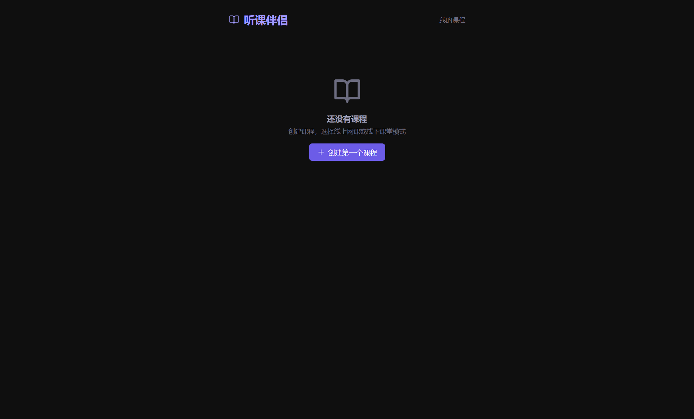
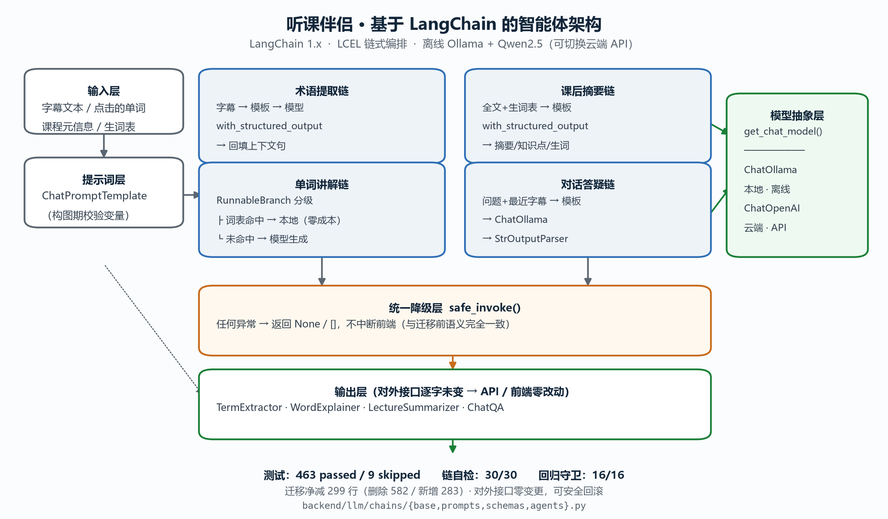
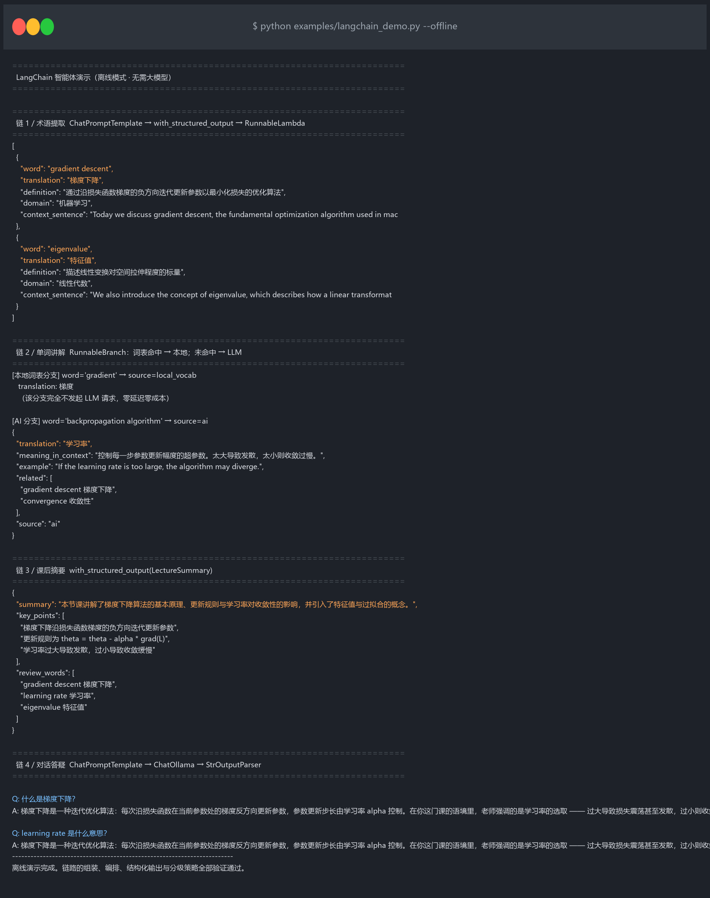

# 听课伴侣 — 实时字幕 · 交互学词


-2f6fb5)

> 🧠 **智能体层基于 [LangChain](https://github.com/langchain-ai/langchain) 1.x 构建**
> —— 四条 LLM 链（术语提取 / 单词讲解 / 课后摘要 / 对话答疑）全部用 LCEL 编排，
> 支持结构化输出与分支路由，本地 Ollama 离线运行。
> 👉 详见 **[🧠 智能体架构](#-智能体架构基于-langchain-的四条-llm-链)**

实时字幕工具，支持**在线网课**和**线下课堂**两种模式。捕获系统音频或麦克风收音，生成逐词同步字幕，点击单词即可学习。完全免费，本地运行。

## 📌 快速导航

| 我想了解 | 看这里 |
|---|---|
| **本次作业（LangChain）怎么做的** | [🧠 智能体架构](#-智能体架构基于-langchain-的四条-llm-链) |
| 作业要求逐条对照 + 一键复现 | [`SUBMISSION.md`](SUBMISSION.md) |
| LangChain 核心代码 | [`backend/llm/chains/`](backend/llm/chains/) |
| 四条链的运行效果 | [`examples/langchain_demo.py`](examples/langchain_demo.py) |
| 术语识别的实测效果 | [术语识别优化](#术语识别优化) |
| 怎么装起来跑 | [快速开始](#快速开始) |

## 📸 应用界面



> 桌面端（Electron + React），左下角为实时逐词字幕，点击任意单词即可查词。

## 核心功能

- 🎤 **实时语音识别** — 基于 Faster-Whisper，本地运行，无需联网
- 🎯 **术语热词注入** — 领域术语表注入 ASR，专业词识别准确率显著提升
- 🏫 **双模式支持** — 在线网课（系统音频捕获）/ 线下课堂（麦克风收音）
- 📝 **逐词高亮字幕** — 精确到单词级别的时间戳同步，中英混合支持
- 🖱️ **点击查词学习** — 点击字幕任意单词，即时显示释义（词库优先，AI 兜底）
- 🤖 **AI 术语提取** — LangChain 结构化输出链，自动提取专业词汇
- 💡 **AI 深度讲解** — LangChain 分支链，结合课程语境解释"这个词在这里什么意思"
- 📋 **课后摘要** — LangChain 结构化输出，一键生成摘要 / 知识点 / 生词复习清单
- 💬 **对话式答疑** — LangChain 对话链，基于最近字幕上下文提问，"刚才那段没听懂"场景
- 📚 **课程专属词典** — 每个课程独立管理词汇，支持生词本和搜索

## 术语识别优化

国外课程最大的障碍是专业术语听不懂、查不到。本项目对此做了针对性优化：

**问题**：Whisper 对专业词识别很差 —— `convolution` 被听成 `convalution`，
`eigenvalue` 被切成 `eigen value`，学生看到的字幕本身就是错的。

**方案**：四层术语热词注入（按优先级从高到低）

| 层级 | 来源 | 说明 |
|---|---|---|
| 1. 自定义术语 | 用户手填 | 课程核心词，识别优先级最高 |
| 2. 课程已识别术语 | 运行中自动累积 | 本课实际出现的词，动态加入 |
| 3. 领域术语表 | 内置 15 个领域 / 320+ 术语 | 覆盖计算机、医学、物理、经济等 |
| 4. 词表短语层 | 内置多词短语 | **按语种自动开关**：`zh`/`yue`/`wuu`/`cmn` 关闭 |

热词通过 Whisper 的 `initial_prompt` 注入，并随识别进程动态更新（无需重启监听）。
Whisper 只保留 `initial_prompt` 的**末尾 223 token**，因此各层按 **token 预算**分配
（默认 220，降级 70），拼接顺序**低优先级在前**，超额时先丢低优先级层。

> 第 4 层只按「含空格」挑词，**只能命中英文** —— 对中文课是纯干扰，故按语种反选关闭。

> 📊 **实测收益（真实中文专业课，人工定稿基准）**
> * 术语层在**词表与课程匹配**时降 CER（24 个课程原生中文术语：召回 36.4% → **71.2%**，CER −4.9%）；
> * 词表**与课程无关**时伤害很大（+42.9%）；
> * 第 4 层（英文短语层）**单独**的代价实测为 **+0.0800 绝对 CER（+38.2%）**，
>   是运行噪声的 **7.41×** —— 该通道已由语种分流修掉。
>
> 详见 [`ASR_Pipeline_Validation_Report.md`](ASR_Pipeline_Validation_Report.md) §9.0 / §9.8。

**配套能力**：

- **本地词表匹配**：内置 3300+ 词，字幕里的术语零延迟匹配入库，完全不依赖 LLM
- **点击讲解分级**：词表命中直接返回（~0ms），未命中的词才调用 AI 讲解，省时省钱
- **术语库可视化**：课程配置页实时预览"这节课会重点识别哪些词"、词库覆盖率

## 两种使用场景

| | 💻 在线网课 | 🏫 线下课堂 |
|---|---|---|
| 音频来源 | 系统音频（WASAPI loopback） | 麦克风 |
| 适用场景 | Coursera / B站 / YouTube | 教室 / 讲座 / 会议室 |
| 识别语言 | 英文为主 | 中英混合 |
| 额外需求 | 无（Windows 下由 PyAudioWPatch 直接采集） | 降噪麦克风（建议） |

> Windows 的 WASAPI 回环采集由 `PyAudioWPatch` 提供，**不需要**安装 VB-Cable
> 之类的虚拟声卡，也不需要在系统声音设置里把默认播放设备改掉。

---

## 🧠 智能体架构：基于 LangChain 的四条 LLM 链




项目的四项 AI 能力（术语提取、单词讲解、课后摘要、对话答疑）全部基于
**LangChain 1.x** 构建，离线运行在本地 Ollama（Qwen2.5）上，可一键切换云端
OpenAI 兼容 API。

### 为什么用 LangChain

最初的实现是「手写 prompt 拼接 + 手写 JSON 正则解析」。它能跑，但在实践中
暴露了三个问题：

| 原实现的问题 | LangChain 的解法 |
|---|---|
| `prompt.format(...)` 漏变量时静默产出畸形 prompt | `ChatPromptTemplate` 在**构图期**校验变量 |
| 模型输出带 ```json 围栏 / 尾随逗号 → 解析静默失败返回空 | `with_structured_output()` + Pydantic schema，框架负责解析与类型校验 |
| 「词表优先、AI 兜底」写成手写 if/else | `RunnableBranch` 声明式表达分支策略 |

### 链路总览

```
┌── 术语提取链 ────────────────────────────────────────────┐
│  字幕文本 ─→ ChatPromptTemplate ─→ 模型 ─→ 结构化术语列表  │
│                                    └→ RunnableLambda 补上下文句 │
└─────────────────────────────────────────────────────────┘

┌── 单词讲解链（RunnableBranch 分级） ────────────────────┐
│                    ┌─ 词表命中 → 本地词库（零延迟零成本）    │
│  点击的单词 ───────┤                                       │
│                    └─ 未命中 → 提示词 → 模型 → 结构化讲解   │
└─────────────────────────────────────────────────────────┘

┌── 课后摘要链 ──────────────────────────────────────────┐
│  字幕全文 + 生词表 ─→ 提示词 ─→ 模型 ─→ 摘要/知识点/生词    │
└─────────────────────────────────────────────────────────┘

┌── 对话答疑链 ──────────────────────────────────────────┐
│  问题 + 最近字幕 ─→ 提示词 ─→ 模型 ─→ 纯文本答案          │
└─────────────────────────────────────────────────────────┘
```

### 代码结构

```
backend/llm/
├── chains/
│   ├── base.py       模型提供方抽象（ChatOllama / ChatOpenAI）+ 统一降级
│   ├── prompts.py    ChatPromptTemplate 提示词模板
│   ├── schemas.py    Pydantic 结构化输出模型（含容错 validator）
│   ├── agents.py     四条业务链的 LCEL 编排
│   └── verify.py     离线自检脚本（30 项检查，无需大模型）
├── client.py         统一 LLM 入口（已切换到 LangChain BaseChatModel）
├── extractor.py      术语提取（薄封装）
├── explainer.py      单词讲解（薄封装）
├── summarizer.py     课后摘要（薄封装）
└── qa.py             对话答疑（薄封装）

examples/langchain_demo.py    链编排演示脚本（离线/真实两种模式）
tests/test_langchain_chains.py  16 项回归守卫
```

### 关键实现要点

**① 模型统一抽象，换模型不改业务代码**

```python
# backend/llm/chains/base.py
def get_chat_model(temperature=0.3, num_predict=1024, model=None) -> BaseChatModel:
    if get_provider() == "cloud":
        return _build_cloud_model(...)   # ChatOpenAI → DeepSeek/Kimi/智谱/OpenAI
    return _build_ollama_model(...)      # ChatOllama → 本地 Qwen2.5
```

**② 结构化输出取代正则解析**

```python
# backend/llm/chains/base.py
def build_structured_chain(prompt, schema, ...):
    def _bind(payload):
        chat_model = get_chat_model(...)
        structured = chat_model.with_structured_output(schema)
        return structured.invoke(prompt.invoke(payload))
    return RunnableLambda(_bind)
```

模型在**调用期**才绑定，因此链本身是可复用的纯结构，
既能注入假模型做离线测试，也能随时换模型。

**③ RunnableBranch 表达分级策略**

```python
# backend/llm/chains/agents.py
return RunnableBranch(
    (RunnableLambda(lambda p: _local_lookup(p) is not None), local_branch),  # 词表命中
    ai_branch,                                                                # AI 兜底
)
```

> ⚠️ 这里有个容易踩的坑：**LLM 可用性检查必须放在分支内部**，不能提到调用之前。
> 原实现的语义是「先查词表，命中立即返回；未命中才检查 LLM」——
> 若提前检查，无 LLM 环境下词表命中的路径会被错误地短路成 `None`。
> `tests/test_langchain_chains.py` 专门为此设了守卫。

**④ 统一降级语义**

所有链经 `safe_invoke()` 包裹，任何异常都降级为 `None` / `[]`，
不会中断前端 —— 与迁移前的失败语义完全一致。

### 运行演示

```bash
# 离线演示：无需大模型，秒级跑通四条链
python examples/langchain_demo.py --offline

# 真实模型：需先启动 Ollama 并拉取 qwen2.5:7b
ollama pull qwen2.5:7b
python examples/langchain_demo.py --live

# 离线自检：30 项检查，覆盖模板/Schema/分支/降级
cd backend && python -m llm.chains.verify

# 回归守卫：16 项
cd backend && python -m pytest tests/test_langchain_chains.py -v
```

实际运行输出（离线模式）：



### 对外接口零变更

LangChain 改造完全发生在 `backend/llm/` 内部。
`TermExtractor` / `WordExplainer` / `LectureSummarizer` / `ChatQA`
四个类的公开方法签名与返回结构**逐字未变**，
因此 `api/routes.py` 与前端**零改动**——这是一个可安全回滚的架构升级。

---

## 技术栈

| 层级 | 技术 |
|------|------|
| 桌面框架 | Electron + React + TypeScript |
| 状态管理 | Zustand |
| ASR 引擎 | Faster-Whisper（默认 `base`，可配置） |
| 语音检测 | Silero VAD（ONNX 后端） |
| 音频捕获 | PyAudioWPatch（WASAPI Loopback，Windows）/ PyAudio（麦克风） |
| 术语提取 | LangChain + Ollama + Qwen2.5（可切换云端 API） |
| 术语热词 | 内置领域术语库 + 自定义术语 → Whisper initial_prompt |
| 本地词典 | ECDICT + 内置词表（3300+ 词） |
| 数据存储 | SQLite |
| 后端 | Python (FastAPI + WebSocket/HTTP 轮询) |
| **智能体框架** | **LangChain 1.x**（LCEL 链 / 结构化输出 / RunnableBranch） |

### 环境变量

| 变量 | 默认值 | 说明 |
|---|---|---|
| `TINGKEBANLV_LLM_PROVIDER` | `ollama` | LLM 提供方：`ollama` / `cloud` |
| `TINGKEBANLV_OLLAMA_MODEL` | `qwen2.5:7b` | 本地模型名 |
| `TINGKEBANLV_CLOUD_API_BASE` | — | 云端 API 地址，如 `https://api.deepseek.com/v1` |
| `TINGKEBANLV_CLOUD_API_KEY` | — | 云端 API 密钥 |
| `TINGKEBANLV_CLOUD_MODEL` | — | 云端模型名，如 `deepseek-chat` |
| `TINGKEBANLV_TERM_PROMPT_MAX` | `800` | 术语热词最大字符数 |
| `TINGKEBANLV_TERM_AUTODEGRADE` | `1` | 检测到字幕重复循环时自动缩短术语提示词（设 `0` 关闭） |
| `TINGKEBANLV_TERM_DEGRADE_TO` | `200` | 降级后保留的提示词字符数 |
| `TINGKEBANLV_TERM_REPEAT_MIN_SAMPLES` | `4` | 判定重复循环所需的最小累计片段数 |
| `TINGKEBANLV_TERM_REPEAT_RATIO` | `1.2` | 判定重复循环的「产出字幕数 / 送入片段数」阈值 |
| `WHISPER_DEVICE` | 自动检测 | `cuda` / `cpu` |
| `TINGKEBANLV_WHISPER_MODEL` | `base` | 模型规格：`tiny`/`base`/`small`/`medium`/`large-v3` |
| `TINGKEBANLV_WHISPER_THREADS` | 自动（≤8） | ctranslate2 的 CPU 线程数 |
| `TINGKEBANLV_VAD_SILENCE` | `0.8` | 静音多久后断句（秒），越大片段越长 |
| `TINGKEBANLV_MAX_PENDING_JOBS` | `8` | 待识别队列上限（背压兜底） |
| `TINGKEBANLV_DISABLE_VAD_MODEL` | — | 设 `1` 强制使用能量检测（排障用） |
| `HF_ENDPOINT` | `https://hf-mirror.com` | 模型下载镜像 |
| `TINGKEBANLV_HOME` | `~/.tingkebanlv` | 数据与模型存储目录（日志落盘于此） |
| `WHISPER_MODEL_DIR` | `<TINGKEBANLV_HOME>/whisper_models` | 模型缓存目录 |
| `TINGKEBANLV_SEED_MODEL_DIR` | 自动推断 | 内置模型种子目录（由主进程传入，覆盖自动推断） |
| `TINGKEBANLV_GPU_SANDBOX` | — | 设为 `1` 恢复 Chromium GPU 沙箱默认行为（排障用） |
| `TINGKEBANLV_PYTHON` | 自动探测 | 指定后端 Python 解释器（打包排障用） |

### 实时性：为什么默认是 base 而不是 small

实测（`scripts/bench_matrix.py`，32 核 CPU，`int8`，8 秒片段）：

| 模型 | 线程 | 2s 片段 | 4s 片段 | 8s 片段 | 15s 片段 |
|---|---|---|---|---|---|
| tiny | 4 | 0.551 | 0.251 | 0.138 | 0.077 |
| base | 4 | 0.908 | 0.482 | 0.249 | 0.164 |
| small | 4 | **2.814** | **1.438** | 0.738 | 0.428 |
| small | 8 | **2.126** | **1.115** | 0.584 | 0.332 |

表内为 RTF（识别耗时 / 音频时长），**必须 < 1**，否则字幕会持续滞后。

关键规律是：**每次调用都有约 4 秒固定开销**，与音频长短几乎无关
（small/4 线程下 2 秒片段耗时 5.63s，而 15 秒片段只耗时 6.42s；Whisper 按 30 秒窗口处理、
短输入会被补齐）。所以片段切得越碎越亏，2 秒片段直接不可用。

据此确定的默认值：`base` 模型 + 自动线程数 + 静音阈值放宽到 0.8s，
让片段自然落在 4~12 秒。若机器较强想换回 `small`，设
`TINGKEBANLV_WHISPER_MODEL=small`，但需注意 4 秒片段上它会跟不上。

运行时可通过 `GET /api/asr/poll` 返回的 `stats` 观察是否降级：
`backlog` 持续 >0 说明跟不上，`mergedCalls` >0 说明已在合并片段，
`droppedSegments` >0 说明开始丢内容。

切换云端 LLM 示例：

```bash
set TINGKEBANLV_LLM_PROVIDER=cloud
set TINGKEBANLV_CLOUD_API_BASE=https://api.deepseek.com/v1
set TINGKEBANLV_CLOUD_API_KEY=sk-xxx
set TINGKEBANLV_CLOUD_MODEL=deepseek-chat
```

## 快速开始

### 前置要求

- Python 3.10+
- Node.js 18+
- Ollama（可选，用于 AI 术语提取）

### 安装

```bash
# 一键安装
bash scripts/setup.sh

# 或手动安装
cd backend && pip install -r requirements.txt
cd frontend && npm install
```

### 安装 Ollama（可选但推荐）

```bash
# macOS / Linux
curl -fsSL https://ollama.com/install.sh | sh

# Windows
# 从 https://ollama.com/download 下载安装

# 拉取推荐模型
ollama pull qwen2.5:7b
```

### 启动开发环境

```bash
npm run dev
```

### 测试

```bash
cd backend && PYTHONPATH=. python -m pytest tests/ -v
```

其中 `tests/test_asr_pipeline_e2e.py` 覆盖音频捕获、VAD、消息队列、术语入库、
背压、**停止收听时的收尾竞态**、**术语提示词重复循环防护**
与完整链路（文件音频 → VAD → Whisper → 字幕）。

端到端用例需要 faster-whisper 模型，未指定时自动跳过：

```bash
TINGKEBANLV_TEST_MODEL_DIR=<含 model.bin 的模型目录> \
  PYTHONPATH=. python -m pytest tests/test_asr_pipeline_e2e.py -v -k end_to_end
```

### 实时性基准

改动 ASR 参数（模型规格、线程数、断句阈值）后，建议用基准脚本确认仍能跟上实时：

```bash
cd scripts
# 单配置：整段 + 分段串行两种口径的 RTF
python bench_asr.py --audio <16k单声道wav> --model base --repeat 6 --segment 8

# 参数矩阵：模型 × 线程 × 片段长度
python bench_matrix.py --audio <wav> --models tiny=/path,tiny,/path --threads 4,8,16

# 单次调用成本曲线（用于判断片段该切多长）
python bench_call_cost.py <wav> /path/to/model_dir 8 5
```

判据是 RTF < 1；同时看「单段平均耗时」，它决定字幕出字延迟。

### 端到端质量评估（准确率 / 推送延迟 / 长时稳定性）

基准脚本只回答「跟不跟得上」（RTF）。用户实际体感由另外三件事决定，用
`scripts/eval_asr_quality.py` 评估：

| 维度 | 指标 |
|---|---|
| 准不准 | WER / CER（音频同名 `.txt` 即逐字稿；缺失则只测实时性） |
| 字幕什么时候到 | 从「这句话说完」到「字幕出现」的延迟（p50 / p95 / max，以及前半段 vs 后半段是否累积） |
| 连续听 10 分钟以上 | 丢弃片段数、合并降级次数、收尾是否干净、是否越拖越晚 |

它复用**真实管道**的 `VoiceActivityDetector` + `WhisperEngine`，只把音频来源从
系统回环换成文件 —— 分段长度、单次调用固定开销、背压与合并行为都与用户实际经历一致。
**不引入新依赖**：不用 `jiwer`，编辑距离自己实现。

```bash
# 0) 先生成压力测试集（基于内置的 jfk.wav 做信号处理，幂等，约 24MB，已 gitignore）
python scripts/make_asr_testset.py
#    tests/audio/short/  → 干净 / 噪声 / 低音量 / 快语速 / 叠话
#    tests/audio/long/   → 12 分钟，含随机长短停顿

# 1) 短用例：准确率 + RTF（尽快喂完，约 25 秒）
PYTHONPATH=backend python scripts/eval_asr_quality.py --audio-dir tests/audio/short

# 2) 长用例：延迟 + 稳定性（按真实速率喂入，12 分钟墙钟）
PYTHONPATH=backend python scripts/eval_asr_quality.py --audio-dir tests/audio/long --realtime

# 3) 术语热词 A/B：同一素材分别跑 --terms on / --terms off
#    也可用 TINGKEBANLV_TERM_PROMPT_MAX 做提示词长度的剂量-反应
PYTHONPATH=backend TINGKEBANLV_TERM_PROMPT_MAX=200 \
  python scripts/eval_asr_quality.py --audio-dir tests/audio/short --terms on

# 4) 只操纵「术语层语种」—— 不动 ASR 的 --language，从而单变量隔离「短语层」：
#    --term-language zh 关掉短语层 / auto 保留（复现修复前行为）
PYTHONPATH=backend python scripts/eval_asr_quality.py \
  --audio-dir tests/audio/short --language zh --terms on --term-language zh
```

> 长短用例**必须分目录**：同目录下一次扫描会把 12 分钟文件也按「尽快喂完」灌进去，
> 人为触发背压丢弃，结论会被污染成「字幕会缺内容」—— 而真实听课不会那样喂。

基准结论与已知限制见 **[`ASR_Pipeline_Validation_Report.md`](ASR_Pipeline_Validation_Report.md)**
（含 12 分钟长测数据、术语热词 A/B 与剂量-反应、以及 `base` 模型的延迟实测）。

## 打包分发

后端与前端产物由 Electron 主进程一并打包，落到安装目录的 `resources/` 下：

| 落点 | 内容 | 用途 |
|------|------|------|
| `resources/backend-server/` | PyInstaller 冻结的后端（自带解释器与依赖） | 安装版的**唯一**启动路径 |
| `resources/backend/` | 后端源码 | 开发/调试兜底（配合 `TINGKEBANLV_PYTHON`） |
| `resources/whisper_models/` | 内置 base 模型种子（含 `manifest.json`） | 服务启动时后台播种到数据目录，**断网即可用** |
| `resources/dist/` | 前端构建产物 | 由 FastAPI 同源托管，前端 `fetch('/api/...')` 无需代理 |

### 为什么必须冻结后端

安装包的目标机器上**没有 Python，也没有任何第三方依赖**。若只依赖解释器，
主进程探测不到可用环境后应用会直接退出。因此后端用 PyInstaller 冻结成
自带解释器、原生库与数据文件的独立可执行文件。

```bash
# 0) 生成内置模型种子（仅首次 / 换模型时执行；产物 packaging/seed/ 是 gitignore 项）
#    源目录可以是已下载好的 faster-whisper base 模型，或 HF 缓存目录
python scripts/prepare_seed_model.py --source <模型目录> --size base
#    产物：packaging/seed/whisper_models/（约 141MB，含 manifest.json + sha256）

# 1) 再冻结后端（须在装有 backend/requirements.txt 的 venv 中执行）
cd frontend && npm run backend:build
#    等价于：
#    python -m PyInstaller ../packaging/backend_server.spec --noconfirm \
#        --distpath ../packaging/out --workpath ../packaging/build
#    产物：packaging/out/backend-server/tingkebanlv-server.exe（约 267MB）

# 2) 最后打 Electron 包
npx electron-builder --win --dir   # 只出解压目录（快，便于自测）
npx electron-builder --win         # 出 NSIS 安装包
```

> 顺序不能反，且**种子缺失必须拦下来**。`npm run package:win` 会把三步串起来并先跑
> `npm run preflight:seed`：种子不存在时直接非零退出，避免打出一个「体积少 141MB、
> 装完首启仍要联网下载」的安装包——这种失败在打包日志里几乎看不出来。

产物位于 `frontend/release/`：`win-unpacked/`（免安装）与 `tingkebanlv-<版本>-setup.exe`。

冻结时特意**排除 torch**（否则 +2GB，而流式转写跑在 CPU + int8 上）与
**hf_xet**（镜像站不代理它的 CAS 服务，代码里已用 `HF_HUB_DISABLE_XET=1` 关闭）。

### 内置模型的分发与自愈

模型**随包分发**（`resources/whisper_models/`），但不在原地使用，理由有两条：
程序目录可能只读、重装即被覆盖；后续想单独更新模型不该让用户重装整个应用。

因此首启会把它**播种**到数据目录，两处职责分明：

| 位置 | 角色 | 可写 |
|------|------|------|
| `<安装目录>/resources/whisper_models/` | 只读种子（真理源） | 否 |
| `<TINGKEBANLV_HOME>/whisper_models/` | 工作副本（faster-whisper 实际加载这里） | 是 |

**触发点有两个，主次分明**：

1. **主路径 —— 后端 `lifespan` 启动钩子**（`backend/main.py` → `start_background_seed`）：
   服务刚起来就丢进后台线程播种，**不阻塞就绪**。首启向导第 3 步读到的
   `/api/asr/model-status` 的 `seeding` 字段就来源于此；播种成功后同一接口的 `ok`
   翻真，界面自动跳到「准备就绪」。设 `TINGKEBANLV_SKIP_BACKGROUND_SEED=1` 可关闭
   （测试与 `--selftest` 用）。
2. **兜底 —— 引擎加载模型时再调一次**（`asr/whisper_engine.py`）：覆盖没走 lifespan
   的加载路径（`--selftest`、脚本、单测）以及「用户没等播种完就点了开始识别」。

两处都走同一个 `ensure_model()`，幂等（先 `check_installed`，已就绪毫秒级返回），
并且共用 `_copy_lock`，因此既不会重复拷贝，也不会和识别抢文件。
`/api/asr/model-status` 本身也兼作**幂等触发点**：探测到模型不可用且没在播种时，
顺手拉起一次后台播种 —— 让「从旧版本升上来、没跑过首启」的用户也能自愈。

播种逻辑见 `backend/asr/model_bootstrap.py`：`ensure_model()` 先校验工作副本，
完整就直接用（`verified`），缺失或损坏就从种子重播（`seeded` / `repaired`），
**全程不联网**。校验用 `manifest.json` 里的 sha256；`--selftest` 会走深度校验，
日常启动只比文件大小（毫秒级）。校验通过后落 `.seed-integrity-<size>.json` 标记，
避免每次启动重算 141MB 的哈希。

只有内置的 base 会随包分发。用户手动导入的 small/medium 没有清单，
校验自动退化为「文件存在且 `model.bin` > 1MB」——这个下界是必要的，
镜像站 + hf-xet 组合曾出现「报下载成功却留下 0 字节 `model.bin`」。

### 后端自检

冻结包最容易漏的不是代码，而是原生库与数据文件 —— 它们只在运行时才炸。
安装后如果「字幕不出来」，先跑自检拿结论：

```bash
"<安装目录>/resources/backend-server/tingkebanlv-server.exe" --selftest
```

它会依次检查 Python 运行时、回环绕过代理、faster-whisper/ctranslate2、onnxruntime、
音频采集后端、内置词表、术语库、前端产物、数据库、**内置模型种子**、
**模型完整性（sha256，损坏自动修复）**、模型缓存，
并在模型可用时**用真实音频跑一次完整识别**（先强制离线加载，
再允许联网修复），最后输出一段可直接粘贴的 JSON 结论，退出码 0/1。

### 打包环境两个常见阻塞点

**1. `Cannot create symbolic link`（winCodeSign 解压失败）**

electron-builder 会下载 `winCodeSign` 工具包，其中含两个 macOS 动态库的符号链接。
Windows 下创建符号链接需要管理员权限或已开启「开发者模式」，否则解压报错中断构建。

三选一：

- 开启开发者模式：设置 → 隐私和安全性 → 开发者选项 → 开发人员模式
- 以管理员身份运行构建命令
- 无需管理员权限的做法 —— 手动预置缓存（只丢弃那两个 macOS 符号链接，Windows 用不到）：

  ```bash
  CACHE="$LOCALAPPDATA/electron-builder/Cache/winCodeSign"
  Z7="frontend/node_modules/7zip-bin/win/x64/7za.exe"
  "$Z7" x "$CACHE/$(ls $CACHE | grep '\.7z$' | head -1)" \
        "-o$CACHE/winCodeSign-2.6.0" -snl -y
  ```

  解压后确认 `rcedit-x64.exe` 与 `windows-10/x64/signtool.exe` 存在即可。

**2. GitHub Release 下载超时 / 502**

`nsis`、`nsis-resources`、`winCodeSign` 均从 GitHub Releases 下载，
国内网络常不可达。走镜像即可（electron-builder 原生支持）：

```bash
export ELECTRON_BUILDER_BINARIES_MIRROR="https://gh-proxy.com/https://github.com/electron-userland/electron-builder-binaries/releases/download/"
```

### 运行时环境适配（无需配置，自动生效）

打包后的应用会在启动时做两件事，避免在受限环境下白屏或闪退：

- 关闭 Chromium **GPU 沙箱**。部分虚拟机 / 远程桌面 / 企业安全策略环境下，
  GPU 进程会以 `0xC0000005` 崩溃并抛出 `FATAL: GPU process isn't usable`，
  导致应用在界面出现前直接退出。
- **首屏看门狗**。同类环境下渲染器沙箱也可能失效，表现为后端与静态资源都正常，
  但渲染器进程卡死、页面永久白屏且无任何报错。若界面 12 秒内未完成加载，
  应用会自行以 `--no-sandbox` 重启一次（约 20 秒内呈现界面），并记录到日志。

运行日志（含后端输出）位于 `<TINGKEBANLV_HOME>/logs/electron.log`，
打包后没有 stdout，排障请直接看这个文件。

## 项目结构

```
tingke-banlv/
├── frontend/              # Electron + React 前端
│   ├── src/
│   │   ├── components/    # UI 组件
│   │   │   └── WordPanel.tsx        # 单词查询面板
│   │   ├── pages/
│   │   │   ├── CourseList.tsx       # 课程列表（含类型选择）
│   │   │   ├── CourseConfig.tsx     # 课程配置
│   │   │   ├── SubtitleOverlay.tsx  # 悬浮字幕
│   │   │   └── DictionaryWindow.tsx # 课程词典
│   │   ├── stores/        # Zustand 状态管理
│   │   └── types/         # TypeScript 类型定义
│   └── electron/          # Electron 主进程
├── backend/               # Python 后端
│   ├── api/               # FastAPI 路由 + WebSocket
│   ├── asr/               # ASR 管道 + Whisper 引擎（含术语热词注入）
│   ├── audio/             # 音频捕获（Loopback + 麦克风）+ VAD
│   ├── llm/               # LLM 层：统一客户端 + 提词/讲解/摘要/答疑
│   ├── dictionary/        # 本地词典 + 术语库（terminology.py）+ 内置词表
│   ├── database/          # SQLite 数据管理
│   └── tests/             # 集成测试
├── scripts/               # 工具脚本
│   ├── eval_asr_quality.py    # 端到端质量评估：WER / 推送延迟 / 长时稳定性
│   ├── make_asr_testset.py    # 合成多场景压力测试集
│   ├── bench_asr.py           # 实时性基准（RTF）
│   ├── bench_matrix.py        # 参数矩阵基准（模型 × 线程 × 片段长度）
│   ├── drive-onboarding.cjs   # CDP 驱动打包应用跑首启向导（6 个模式）
│   ├── icon_assets.py         # 应用图标产物层校验（ico 规格 + exe 内嵌图标对拍）
│   └── verify_install.py      # 安装包实装验证
├── docs/
│   └── m3/                # M3 文档（设计稿 + 实现说明 + 验收记录）
│       ├── onboarding_wizard.md      # 首启向导：分步文案 + 热键 + 降级开关说明
│       ├── icon_asset_spec.md        # 应用图标：多尺寸清单 + 嵌入位置 + 验收
│       └── backlog_b1_b2_b3.md       # UI 缺陷 Backlog（B1–B5，已全部修复）
└── ASR_Pipeline_Validation_Report.md   # ASR 管道验证报告（P3 里程碑）
```

## 使用流程

1. 创建课程 → 选择课程类型（在线网课 / 线下课堂），填写名称、领域、术语
2. 进入课程配置 → 调整领域和自定义术语
3. 点击「开始识别」→ 窗口缩小为悬浮字幕条，开始实时识别
4. 点击字幕中的任意单词 → 查看释义
5. AI 自动提取专业术语 → 积累课程专属词典

## License

MIT
